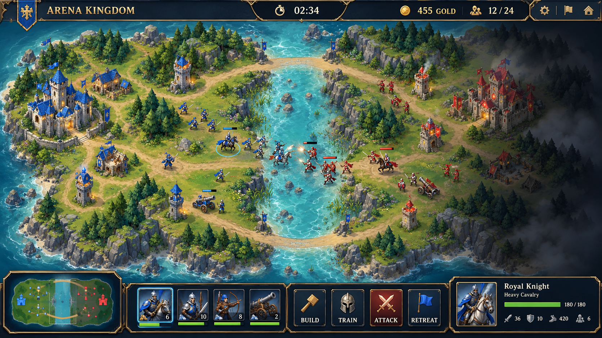

# Arena Kingdom — Nâng cấp đồ họa theo hướng Liên Minh Huyền Thoại

Ngày: **11/10/2026**. Bổ sung cho [đánh giá nâng cấp toàn diện](UPGRADE_REVIEW.vi.md).

**Yêu cầu đã chọn:** RTS 1v1 cạnh tranh, online công bằng; mỹ thuật lấy cảm hứng từ Liên Minh Huyền Thoại. Đây là hướng thiết kế và kế hoạch triển khai, chưa phải thay đổi game đã chạy.

**Điều chỉnh đã chốt khi triển khai:** bỏ sông và đường nối trên map. Bản đầu dùng mặt cỏ liên tục, chỉ giữ biển ngoài đảo, vách đá đúng collision và nền công trình nhỏ. Sông/đường trong concept bên dưới thuộc ý tưởng cũ và không xuất hiện trong bản game mới. Kết quả runtime và kiểm thử được ghi trong [báo cáo triển khai](IMPLEMENTATION_RESULT.vi.md).

## 1. Hình ảnh mục tiêu

Chiến trường fantasy nhìn từ trên xuống, vật thể thể hiện chiều cao bằng mặt bên và bóng đổ: mặt cỏ có biến thiên tự nhiên, đường đất mòn, vách đá nhiều lớp, rừng thành cụm, nước có bờ và gợn nhẹ. Hai vương quốc có kiến trúc fantasy nguyên bản, cờ và điểm nhấn blue/crimson. Quân xuất hiện như những đội lính có hình dáng rõ thay cho ký hiệu sa bàn hiện tại.

Hướng này lấy cảm hứng từ ngôn ngữ thị giác MOBA của Liên Minh: địa hình fantasy có chiều sâu, đội hình dễ đọc và HUD tối có viền kim loại. Arena Kingdom tiếp tục là RTS điều khiển quân đội 1v1. Tài liệu tham khảo chính thức cho cách bản đồ Liên Minh tổ chức căn cứ, đường tiến quân, rừng và fog: [Riot — How to Play](https://www.leagueoflegends.com/en-us/how-to-play/). Bố cục Arena vẫn lấy geometry/rules của game hiện tại.

Asset, nhân vật, công trình, huy hiệu và bố cục map thiết kế riêng. Tất cả hình ảnh triển khai cần được tách thành terrain, sprite, icon và VFX; ảnh concept toàn màn hình dùng để định hướng, không đưa nguyên ảnh đó vào làm nền có unit/HUD vẽ sẵn.

**Ảnh concept do AI tạo để review mỹ thuật, chưa phải screenshot của game đã nâng cấp.** Tên/thông số trong HUD, vị trí vật thể và chi tiết địa hình của concept là minh họa; implementation phải khớp tên/chỉ số trong rules và collision geometry hiện tại. File: `docs/concepts/moba-graphics-concept.png`.

## 2. Terrain và bản đồ

| Thành phần | Nâng cấp đề xuất | Điều kiện gameplay |
| --- | --- | --- |
| Mặt cỏ | Texture vẽ tay có mảng sáng/tối, cỏ thấp ở vùng quân đi, cụm hoa nhỏ ở biên | Không làm unit chìm vào nền hoặc nhầm hoa với đối tượng tương tác |
| Đường hành quân | Đất nén, đá lát vỡ, mép cỏ mềm; đường dẫn hướng đọc map | Khớp hành lang walkable hiện tại; đường trang trí không tự tạo bonus tốc độ |
| Rừng | Cây có tán nhiều lớp, bóng mềm, bụi thấp; canopy giảm opacity khi che quân mình | Chỉ có collision/concealment nếu shared engine định nghĩa; cây trang trí không tự thay fog |
| Núi/vách đá | Mặt trên/mặt bên rõ, khe núi và lối qua dễ nhìn | Vẽ từ `MOUNTAIN_RIDGES`; vị trí bị chặn phải nhìn thấy ở mọi skin |
| Sông/nước | Turquoise, đá ngầm, bờ cát/đá, gợn và foam nhẹ | Vùng nước đi được thể hiện thành chỗ cạn; muốn đổi địa hình vật lý phải thành task rules/balance riêng |
| Căn cứ | Sân đá, cổng, cờ, điểm sáng đội và đường nối công trình | Footprint xây dựng/hit testing khớp engine, không đổi tọa độ chỉ vì sprite cao |
| Props | Tàn tích, cọc gỗ, thảm cỏ, đèn nhỏ ở vùng ngoài hành lang chính | Có ngân sách density; không che quân/selection/đạn |

Đề xuất bảng màu riêng: rừng `#294B3A`, cỏ `#6F8C5A`, đá `#465560`, nước `#2D7F91`, HUD `#0C1B26`, kim loại `#B69A62`, blue `#3CA8FF`, crimson `#F05A62`. Đây là palette đề xuất cho Arena, không phải thông số màu chính thức của Riot.

Ánh sáng giả lập từ trên-trái, bóng xuống-phải. Phân lớp: terrain → props → bóng → công trình/quân theo chân sprite → health/selection → projectile/VFX → fog → HUD. Độ sâu sprite phải theo tọa độ chân để vật thể không chồng sai khi quân đi qua.

## 3. Sprite quân và công trình

| Entity | Silhouette/đặc trưng | Animation |
| --- | --- | --- |
| Soldier | Khiên và kiếm, giáp gọn, cờ/mảnh áo màu đội | Idle, walk, attack, hit, death |
| Archer | Dáng nhẹ, cung rõ, áo choàng ngắn | Walk, kéo cung/bắn, hit, death |
| Knight | Ngựa và kỵ sĩ, tỷ lệ dài hơn Soldier, giáp có điểm sáng | Chạy, tấn công, hit, death |
| Scout | Trang bị nhẹ, dấu nhận diện trinh sát | Idle, chạy, hit, death; không thêm attack không có trong rules |
| Cannon | Khung gỗ/kim loại, bánh xe và nòng pháo rõ | Di chuyển, giật nòng, smoke ngắn, death |
| Militia | Trang bị thô, ít giáp, nhận diện khác Soldier | Walk/attack đơn giản, death |
| Royal Guard | Giáp nặng, crest/vương miện nhỏ | Deploy, walk, attack, return, death; giữ cơ chế ẩn/AI hiện có |
| Castle | Đá fantasy, tháp và mái, cờ đội, điểm sáng trong sân | Idle flag, bắn, damaged, destruction |
| Village | Cụm nhà mái ngói/gỗ, tỷ lệ thấp hơn Castle | Idle nhẹ, damaged, destruction |
| Barracks | Sân tập và cổng, banner binh chủng | Training indication, damaged, destruction |
| Tower | Thân đá thẳng, vị trí bắn rõ | Fire, damaged, destruction |
| Fence | Gỗ/đá có chiều dày, endpoint nhìn rõ | Đủ tám rotation, damaged/destroyed |

Triển khai sprite atlas từng nhóm; lượt đầu có thể dùng idle/walk/attack/death với 4 hướng. Chỉ tăng lên 8 hướng sau khi chất lượng/chi phí được đo. Team tint chỉ ở vải/cờ/crest; không tint toàn sprite làm mất chất liệu. Selection ring, health bar và crest giúp phân biệt đội ngoài màu sắc.

Icon menu và sprite battlefield phải cùng thiết kế: Cannon trong shop nhận ra ngay trên map, Scout không nhầm Soldier. Ký hiệu formation giữ vai trò overlay có thể bật; sprite quân vẫn là đối tượng chính. Điểm click/hit-area dùng footprint/screen pixels rõ ràng, không phụ thuộc vùng alpha ngẫu nhiên trong PNG.

## 4. Combat VFX và fog

- Tên có trail mảnh và impact ngắn; Cannon có muzzle flash, đạn, smoke và splash ring đúng bán kính gameplay.
- Đòn melee có slash ngắn, damage flash tiết chế. Công trình hư hại có crack/smoke theo HP; destruction có fade/debris ít hạt.
- Lệnh Move/Attack/Fall Back có marker và màu/shape riêng; ưu tiên thấy được trên cỏ, đá và nước. Animation decorative hỗ trợ reduced motion.
- Fog chuyển từ cloud lớn che loang sang mask dễ đọc: chưa khám phá tối hơn, vùng từng biết có tone mờ nếu memory policy cho phép, vùng thấy hiện tại rõ. Viền mềm là phần trình bày; entity/event visibility luôn theo server/shared engine.
- Cây, nước, cờ và thời tiết chuyển động chậm; tách toggle nature/weather. Mỗi trận ranked dùng cùng ruleset cho hai bên; graphics quality không thay visibility, hitbox hoặc khả năng đọc đối thủ.
- Pool effects và giới hạn số particle/projectile trình bày. Lượt đầu dùng alpha/additive sprite nhỏ, tránh full-screen bloom/blur hoặc camera shake kéo dài.

Không hiển thị hiệu ứng của entity ẩn. Cosmetic weather phải có description đúng; tactical weather cần task simulation và balance riêng như báo cáo chính.

## 5. HUD, camera và màn hình phụ

**Desktop:** thanh trên gọn cho tên đội, HP Castle, thời gian, gold/supply và trạng thái mạng. Dưới giữa là portrait nhóm đang chọn, HP/count, hàng lệnh và tuyển quân; góc có minimap đúng fog/perspective khi camera hỗ trợ zoom/pan. Menu xây/tuyển dùng icon fantasy, giá vàng, trạng thái disabled và tiến trình rõ. Tooltip có hotkey và giải thích ngắn.

**Mobile:** header chia hai hàng khi cần, Leave và clock luôn thấy; command bar theo grid, nút chính ≥44px. Tap chọn quân/nhóm, nút Move/Attack rõ; drag/pinch dùng cho camera khi không ở selection mode. Minimap thu gọn có thể mở rộng. Không scale cả HUD desktop xuống cùng canvas.

Theme: nền xanh đen, border đồng/vàng cũ, điểm sáng blue/crimson; khung ít chi tiết ở vùng thao tác. Chữ và số đọc được ở 360px. Viền/texture chỉ hỗ trợ hierarchy; trạng thái chọn, lỗi, reconnect và unit cap không phụ thuộc glow.

Đồng bộ lobby, loading screen, settings, battle results và recap: cùng portrait/icon/typography, cùng palette và border. Settings chỉ có một owner; phím O và click mở cùng panel. Modal quản lý focus/keyboard đúng và giảm motion theo preference.

Camera giữ world 1920×1080 hiện tại; 2.5D là art và sorting. Pan/zoom/clamp có transform ngược chính xác khi drag-select, đặt công trình, nhắm mục tiêu và bấm minimap. Nhận diện quân phải tốt ở mức zoom mặc định; không dùng zoom để che vấn đề sprite/hit-area.

## 6. Tích hợp vào code hiện có

| Khu vực | Trách nhiệm trong nâng cấp |
| --- | --- |
| `client/src/game/mobaMapArt.ts`, `mapArt.ts` | Terrain generation/layer; lấy cùng shared geometry, cache lớp tĩnh |
| `shared/src/island.ts` | Nguồn geometry terrain vật lý; thay art không sửa luật ngầm |
| `client/src/game/visuals.ts`, `art.ts`, `symbols.ts` | Asset manifest, sprite/icon resolution, fallback, chân sprite và depth |
| `client/src/game/BattleScene.ts` | Sync sprite, animation state, fog, camera, pooled VFX |
| `client/src/game/GameController.ts`, `styles.css` | HUD responsive, selection info, icon commands, keyboard/touch |
| `displaySettings.ts`, `displaySettingsPanel.ts` | Một panel; preset Low/Medium/High, motion, nature/weather |
| `battleRecap.ts`, `battleRecap.css` | Giữ perspective và style nhất quán, recorder freeze sau end |

Giữ asset/render pipeline dưới route `/battle`; lobby tải icon/portrait nhỏ khi cần. Asset loader có progress, fallback và retry có giới hạn; báo lỗi tải rõ, không để battle trắng. Không thêm engine 3D hoặc framework mới để đạt phong cách này.

## 7. Ngân sách hiệu năng và tiêu chí nghiệm thu

Các con số sau là **mục tiêu cần đo khi triển khai**, chưa phải kết quả đạt được:

- Lượt tải đầu dùng starter graphics pack khoảng ≤1.5MiB compressed; detail pack cho High tải sau khi battle sẵn sàng. Điều chỉnh mục tiêu sau khi có asset mẫu và đo chất lượng.
- Atlas tối đa 2048×2048; Low dùng bản 1024 khi chất lượng cho phép. Texture memory có budget riêng cho preset và thiết bị tham chiếu; không chỉ kiểm tổng file trên đĩa.
- Terrain tĩnh render/cache một lần; weather/nature cập nhật cadence thấp hơn nơi không ảnh hưởng quân. Combat/state authoritative giữ tick hiện tại.
- Desktop tham chiếu p95 frame time ≤16.7ms; máy yếu Low ≤33.3ms. Đo lúc đông quân, Cannon splash, fog nhiều vision sources, replay và resize; không cam kết mọi máy đạt 60FPS.
- Reduced motion tắt bob/overshoot/drift và các chuyển động trang trí; chuyển động quân và projectile cần thiết vẫn dễ hiểu. Tắt VFX không tạo lợi thế đọc enemy ngoài luật.
- Kiểm 1440, 1366, 390 và 360px; không HUD overlap/scroll ngang, không broken texture, không che chỗ bị chặn hoặc làm unit khó chọn.
- Chạy typecheck, shared/integration tests, build và bundle/asset budget. Đối chiếu network snapshots, fog và collision trước/sau: presentation không đổi HP/DPS/range, geometry, economy hoặc Elo.

## 8. Thứ tự triển khai đồ họa

1. **Terrain + HUD nền:** sửa settings duplicate và mobile overlap; xây palette/tokens; art thể hiện đúng ridge/shallow water; chốt một default MOBA style và đồng bộ QA/docs.
2. **Quân + công trình:** một Soldier/Archer/Castle mẫu để kiểm silhouette/scale, sau đó đủ roster và tám fence rotation; original icons, team identity, atlas/fallback.
3. **VFX + camera:** fog mask, attack/move markers, combat feedback, zoom/pan/minimap, touch mode; kiểm visibility và transform/hit testing.
4. **Polish + profile:** nature/weather tiết chế, quality presets, reduced motion, lobby/results/recap và asset budgets; kiểm đông quân/thiết bị yếu.

Đồ họa được làm song song theo gói sau khi những dependency correctness liên quan đã được xử lý. Trước phát hành ranked rộng rãi vẫn phải hoàn tất protocol, formation, fog policy và ranked admission trong báo cáo chính. Chưa có yêu cầu commit/push/deploy cho phần đề xuất này.

## 9. Trạng thái kiểm tra bổ sung

Thay đổi lần này chỉ gồm tài liệu định hướng và ảnh concept. Đã kiểm tra file ảnh tồn tại, liên kết ảnh/tài liệu đúng và Git diff không thay source/lockfile. Không chạy lại typecheck/build vì không có thay đổi runtime; kết quả 61/61 tests và build pass trong báo cáo chính thuộc lượt đánh giá trước. Các lỗi QA/static, protocol, fog/ranked và mobile nêu trong báo cáo chính vẫn chưa được sửa.
