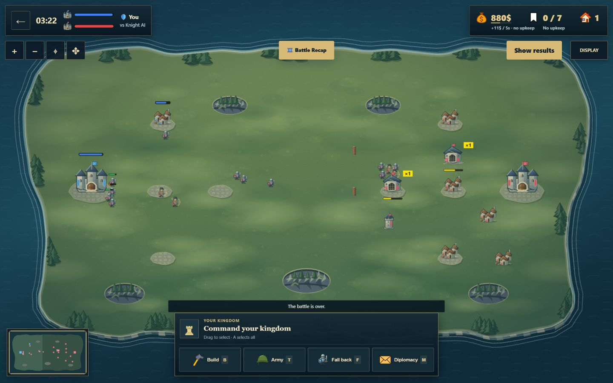

# Arena Kingdom v0.8 — Kết quả triển khai

Ngày bàn giao: **12/10/2026** (Asia/Saigon). Mốc được nâng cấp: `cc5d681`. Độ phức tạp thực tế: **Phức tạp**; cấp model đề xuất: Codex mạnh cho engine/protocol/ranked, kết hợp review độc lập. Không tự đổi model trong phiên.

Người dùng đã chốt RTS 1v1 online công bằng, đồ họa fantasy lấy cảm hứng từ Liên Minh Huyền Thoại, bỏ sông/đường trên map và cập nhật GitHub khi hoàn thành. Đây là **đợt nâng cấp đầu v0.8**, không phải toàn bộ roadmap dài hạn trong [đánh giá ban đầu](UPGRADE_REVIEW.vi.md). Đích phát hành là `main` của [JackSilver08/Arena-Kingdom](https://github.com/JackSilver08/Arena-Kingdom). SHA và kết quả push được xác nhận khi bàn giao.

## Những thay đổi đã thực hiện

| Nhóm file | Kết quả và nguyên nhân sửa |
| --- | --- |
| `shared/src/network.ts`, `engine.ts`, `formations.ts`, `types.ts` | Protocol **6** tách bits loại quân/rearguard/retreat vốn bị chồng; từ chối client cũ. Defense multiplier lớn hơn 1 giảm sát thương nhận. Lệnh không thể dò/bám mục tiêu ẩn; mất vision chỉ tiếp tục đến vị trí đã thấy. DTO loại bỏ nội bộ engine, kinh tế/thống kê địch được che trong trận và mở ở cuối trận; sự kiện bắn không lộ vị trí ẩn. |
| `server/src/online/`, `http/matchmaking.ts`, `rooms/ArenaRoom.ts`, `index.ts`, `middleware.ts`; client `session.ts`, `rankedQueue.ts`, `pages/play.ts` | Server ghép ranked theo rating mở rộng theo thời gian, cấp chỗ và xác nhận riêng; client không tự tạo ranked. Private không đổi Elo, không xuất hiện trong discovery. Một tài khoản giữ tối đa một queue/reservation/room online; reconnect giữ seat và thời gian chờ phù hợp. Giới hạn body **32 KB**, timeout **5 s**, protocol và rate limit được áp vào HTTP matchmaking thực tế. Sửa crash URL sai, cancel queue/pairing và cleanup khi handoff thất bại. |
| `fantasyArt.ts`, `terrainArt.ts`, `mobaMapArt.ts`, `mapArt.ts`, `art.ts`, `visuals.ts` | Asset SVG nguyên bản: **7 loại quân, 5 công trình, 2 đội**; silhouette và điểm nhấn màu đội thống nhất. Cỏ, cây, vách đá và bờ đảo có lớp sáng/tối; cả ba skin dùng cùng geometry núi thực. **Bỏ sông nội địa, đường nối và đoạn lát đường**, kể cả fallback/minimap. Giữ biển ngoài đảo và nền nhỏ dưới công trình. Không đổi collision/pathfinding hoặc dùng tài nguyên Riot. |
| `BattleScene.ts`, `battleLayout.ts`, `cameraMath.ts`, `touchCameraGuard.ts`, `battleMinimap.ts`, `fogOfWar.ts`, `presentationVisibility.ts` | Zoom/pan, camera mode, minimap click/phím và view portrait dễ đọc hơn. Lệnh dùng đúng tọa độ camera; pinch không phát lệnh quân khi nhấc tay. Fog/last-known dựa trên view hiện tại; reset kiến thức khi tua lại. Main canvas giới hạn cạnh **4096 px**, **4.194 MP**, DPR tối đa 2; terrain Low/Medium/High tối đa **1024/1536/2048 px** theo cạnh dài. |
| `GameController.ts`, `battleTheme.css`, `displaySettings*.ts`, `livingForest.ts`, `weatherOverlay.ts`, `pages/battle.ts`, `styles.css` | HUD xanh đen/đồng, thông tin quân chọn và HP, nút camera; layout desktop/mobile. Một chủ sở hữu settings, phím O đúng panel; quality/nature/weather riêng, focus và reduced motion. Giới hạn effect pool **24/48/90** theo quality. Modal kết quả không bị settings/recap che; số liệu đủ tương phản. |
| `battleRecap.ts`, `GameController.ts`, `BattleScene.ts` | Recorder lấy mẫu khoảng **250 ms**, đóng băng sau frame kết thúc đầu tiên. Tối đa **9000 frame**, giữ đầu/cuối khi cần thu gọn. Tua không tạo lại slider hoặc mất focus; HUD, quân số, fog và danh sách sự kiện theo đúng thời điểm, không mang trạng thái cuối trận về đầu trận. |
| `shared/src/weather.ts`, `shared/scripts/balance.ts`, `pages/guide.ts`, `components/layout.ts`, packages/lockfile, `tools/` và tests | Thời tiết ghi rõ chỉ trang trí; guide theo luật hiện tại, footer/version đồng bộ **0.8.0**. Balance controller dùng giá/visibility đúng. QA bao gồm client/server tests và ngân sách runtime asset; cập nhật dependency tương thích, không ép major upgrade. |

## Kiểm chứng đã chạy

- `npm ci`: pass, lockfile đồng bộ với các workspaces.
- `npm run qa`: **pass** — 14 static checks, typecheck shared/client/server, **128 tests** (**74 shared + 36 client + 18 server**), production build ba workspaces và bundle budgets.
- Sau chỉnh text footer dùng `GAME_VERSION`: client typecheck, client build và bundle check chạy lại, đều pass. Không thêm test chỉ để kiểm một label.
- Server integration tests dùng API và Colyseus thật với SQLite riêng: ranked/private/auth/admission/protocol/reconnect/cancel, request quá lớn/chậm, URL sai và account rate limits. Không thay dữ liệu người chơi thật.
- Review độc lập đã tìm và sửa các lỗi URL crash, thời gian lease khi reconnect, rate limit người dùng chung IP, queue cleanup và canvas portrait quá lớn; review server cuối không còn blocker trong phạm vi đợt này.
- Browser local: **1440×900, 1366×768, 390×844, 360×800**; không tràn ngang, không broken art, không console warning/error trong trận đã thử. Camera buttons 44×44 px, nút lệnh mobile cao 52 px. Thử chọn/ra lệnh quân, xây village, zoom, camera drag, settings O, đổi quality/skin/reduced motion, modal kết quả và recap.
- Recap thực tế: về `00:00` hiển thị **110 vàng, 3/12 quân, 3 village, 0 quân địch visible**; không hiện sự kiện tương lai; slider giữ focus sau Home/ArrowRight; phát 2× tiến thời gian; đóng khôi phục HUD cuối trận và focus kết quả. Số sự kiện ghi giữ nguyên sau kết thúc.
- Browser tích hợp không hỗ trợ `Input.dispatchTouchEvent`; **chưa xác nhận pinch trên thiết bị cảm ứng thật**. Logic gesture/camera đã có regression tests, camera drag đã thử qua UI.
- HEAD các route local `/`, `/play`, `/guide`, `/battle?mode=ai`, `/leaderboard`, `/history`, `/login`, `/health`: **200**. Health báo **0.8.0**. Cả bốn asset CSS/JS build cuối: **200**, CSS `text/css`, JS `text/javascript`.
- `git diff --check`: pass. Không đưa `.env`, DB, logs, `node_modules`, build/cache vào commit.

Ảnh battlefield thực tế của bản mới (concept sông/đường trong tài liệu cũ đã bị thay thế):



## Ngân sách và giới hạn còn lại

- Runtime build: **1655.5 KiB / 4096 KiB**, binary asset **0 / 1536 KiB**. Phaser/battle tách khỏi tải trang đầu; main JS **296.48 kB / 98.57 kB gzip**, battle JS **1324.95 kB / 368.91 kB gzip**. Concept và screenshot trong docs không nằm trong runtime bundle. Đây là số build, không phải kết quả FPS/PageSpeed.
- Audit dependency giảm từ **17** (3 critical, 2 high) xuống **13** (**0 critical, 1 high, 10 moderate, 2 low**). Cảnh báo còn lại nằm trong chuỗi Colyseus 0.16 và dependency liên quan, gồm nanoid cũ. Chưa tuyên bố sạch security audit; cần một đợt migration Colyseus có kiểm tra protocol/reconnect riêng.
- Balance smoke test 6 trận hoàn tất, không draw; thời lượng khoảng **5.69–13.81 phút**. Mẫu nhỏ và RNG chưa deterministic, chưa đủ để kết luận cân bằng thi đấu.
- Ranked queue/lease/rate buckets hiện **một process**. Chưa hỗ trợ shared presence cho nhiều instance, anti-collusion nâng cao, season/region hoặc load test online đông người.
- Recap là dữ liệu perspective trong bộ nhớ của phiên; chưa phải server replay lưu/share được, chưa deterministic command log. AI history local vẫn chưa được server chứng thực; auth/token revocation và durable result outbox là roadmap riêng.
- Chưa đo FPS/P95 trên điện thoại thật, chưa kiểm mạng mất gói hoặc triển khai production/PM2/Nginx/TLS. Không thay cơ chế auth, schema DB hoặc production. Push GitHub là cập nhật source, không tự deploy.

## Chạy và kiểm lại

Yêu cầu Node **22.13+** (24 khuyến nghị). Từ repo:

```powershell
npm ci
npm run qa
# Dùng DB riêng khi thử, tránh trộn với dữ liệu đang có.
$env:DATABASE_PATH = 'database/upgrade-local-20261011.db'
$env:PORT = '2567'
npm start
```

Mở `http://localhost:2567/play` để thử AI hoặc đăng nhập hai tài khoản test để thử online. Client/server cũ phải cập nhật cùng nhau vì protocol 6. Không xóa các DB local đã có để chạy bản mới.

Rollback source bằng một commit revert được review và build lại client/server cùng phiên bản; DB schema không đổi trong đợt này. Không force push hoặc reset dữ liệu.
